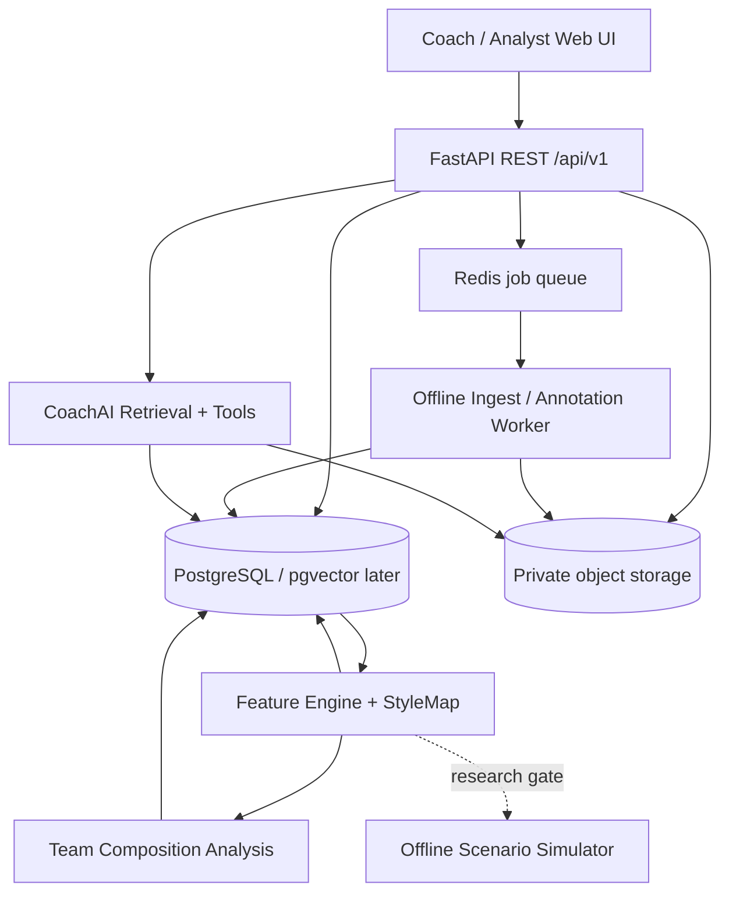

# VALOMIND — COMPLETE CODEX MASTER SPECIFICATION

> This single file concatenates all repository Markdown instructions. For development, prefer full ZIP with machine-readable `spec/` and `fixtures/`.

> Version 1.0, 2026-10-20. Docs are blueprints, not implemented functionality.


---

## FILE: `README.md`


# ValoMind — AI Player Intelligence and Coaching

**Status:** engineering specification / staged implementation blueprint, not a claim that an implementation already exists.  
**Version:** 1.0 · **Date:** 2026-10-20 · **Primary implementation assistant:** Codex.

> **Mission:** Turn authorized, offline VALORANT match footage and structured annotations into evidence-backed player behavioral profiles, role-independent playstyle groups, team-composition insights, and coach-facing answers. A later research phase evaluates player-action prediction and bounded scenario modeling.

## How to hand this project to Codex

1. Give Codex this whole folder (or the downloadable ZIP) in a repository or workspace.
2. Start with `CODEX_START_HERE.md`, then `AGENTS.md`, `TASKS.md`, and `docs/01_PRODUCT_PRD.md`.
3. Tell Codex: **"Implement ValoMind iteratively following AGENTS.md and TASKS.md. Start at M0, use mock/synthetic demo assets without external permissions, make each vertical slice executable and tested, and do not silently skip acceptance criteria. Produce code, docs, tests, migration, and run instructions."**
4. Do not supply Riot keys, private VODs or other secrets in prompts; inject secrets through environment configuration once explicitly authorized.

## Documents

| File | Purpose |
|---|---|
| `CODEX_START_HERE.md` | First Codex prompt, sequencing, definitions of done |
| `AGENTS.md` | Mandatory engineering behavior and guardrails for agentic coding |
| `TASKS.md` | Trackable implementation backlog and milestones |
| `docs/01_PRODUCT_PRD.md` | Personas, goals, workflows, acceptance requirements |
| `docs/02_SYSTEM_ARCHITECTURE.md` | Services, boundaries, deployment and observability |
| `docs/03_DATA_ACCESS_AND_COMPLIANCE.md` | Riot policy, provenance, permissions and prohibited features |
| `docs/04_DATA_MODEL_AND_EVENT_SCHEMA.md` | Canonical event taxonomy, data types, validation, storage |
| `docs/05_VOD_ANNOTATION_PIPELINE.md` | Ingestion, timestamps, labeling, QA and computer vision rollout |
| `docs/06_PLAYER_TWIN_AND_STYLE_CLUSTERING.md` | Cross-role player categories, debiasing, embeddings, comparisons |
| `docs/07_TEAM_COMPOSITION_AND_SIMULATION.md` | Agent picks, team chemistry and safe research simulations |
| `docs/08_COACH_AI_RAG_AND_EVAL.md` | Retrieval, tools, answer evidence, AI evaluation |
| `docs/09_API_SPEC.md` | Endpoint behaviors, pagination, errors, authorization |
| `docs/10_FRONTEND_UX.md` | Routes, UI states, interaction and accessibility |
| `docs/11_IMPLEMENTATION_ROADMAP.md` | Dependency ordered engineering phases |
| `docs/12_TESTING_SECURITY_AND_OPERATIONS.md` | Security, QA, performance, production readiness |
| `docs/13_PITCH_AND_RESEARCH.md` | Portfolio demo, coaching research and validation |
| `docs/14_DECISIONS_AND_RISKS.md` | Architectural decisions, open dependencies and mitigations |
| `docs/15_GLOSSARY.md` | Domain vocabulary to avoid category ambiguity |
| `spec/openapi.yaml` | API contract draft; expand while implementing |
| `spec/schema.sql` | Starter PostgreSQL schema; evolve with migrations |
| `fixtures/` | **Synthetic** examples for tests/demo only |

## First achievable demonstration

An analyst creates a private workspace, uploads authorized footage, labels five rounds, reviews validated events, generates a player profile, inspects **role-agnostic similarity** between two players on different VALORANT agent picks, and asks CoachAI a question answered with source clips and confidence limitations.

## Hard boundaries

- **Offline after-match analysis only**; no gameplay overlay, cheat, memory reading, packet sniffing, client hooks, or current-opponent pre-match scouting.
- Do not equate VALORANT **agents** (playable characters) with ValoMind **AI agents** (software reasoning/model components).
- Do not claim footage reveals intent or private team communications; infer only observable behavior and explicitly state uncertainties.
- All player-specific shared data needs appropriate permissions/opt-in and access control; obtain necessary Riot approval before launching a public product. See compliance doc.
- Features requiring unavailable telemetry or rights must stay feature-flagged or synthetic until authorized.

## Source-of-truth order

Policy and legal constraints > real licensed data availability > specification > code assumptions. Where docs conflict, record an ADR and fix the docs. All sample measurements in fixtures are invented and must never be portrayed as real observations.


---

## FILE: `CODEX_START_HERE.md`


# Codex: Read This First

You are the implementation agent for **ValoMind**, an offline, permission-based, VALORANT player-behavior analysis and coaching research platform. Treat this directory as the implementation contract. The goal is a working repository, not a UI mockup or generated ideas.

## Immediate execution instructions

1. Read `README.md`, `AGENTS.md`, `TASKS.md`, `docs/03_DATA_ACCESS_AND_COMPLIANCE.md`, and the PRD before writing code.
2. Inspect existing repository state; **do not overwrite pre-existing project work** without reason. If the repository is empty, bootstrap a monorepo with Next.js/TypeScript web, FastAPI/Python API, Python worker, Postgres with pgvector (optional at MVP), Redis, local MinIO (optional), Alembic migrations, pytest, Vitest and Playwright.
3. First finish milestone M0 and M1 from `TASKS.md`: development environment, synthetic fixtures, schema, authenticated private workspace, uploads metadata, and annotations; test these end-to-end.
4. Then M2 player profile and **role-independent style comparison**. Do not wait for a GPU, Riot production API, proprietary esports feeds, or externally sourced player footage. Use manual annotations and synthetic demo fixtures.
5. Produce migrations, API docs, typed clients, tests, README run commands, environment examples, and actual screenshots only when you can render the app. Never claim completed features based on stubs.
6. After each milestone, run tests and lints, record actual results and known blockers in a milestone report. Mark tasks complete only if acceptance tests pass.
7. If a decision is not specified, choose the smallest reversible implementation, document it in an ADR, and proceed. If a compliance-sensitive dependency is unknown, **disable that feature**, not the project.

## Mandatory domain behavior

The defining feature is that **two players may be categorized as stylistically similar even if one uses a Duelist agent and the other a Sentinel/Controller/Initiator agent**, provided sufficient comparable in-game situations exist. Implement role-normalized evidence and expose sample coverage, uncertainty, and within-role versus cross-role comparison diagnostics. Never simply cluster by agent picks, K/D, ACS, position labels or map composition.

Also model **the VALORANT agent lineup composition** (five characters selected by a team) as separate from **human player behavioral categories** and separate from **AI software agents**. Treat team synergy as a context-conditioned hypothesis requiring data, not an invented magical score.

## Implementation quality contract

- No real gameplay data unless explicitly permissioned. Demo must visually label synthetic data.
- No fake API success, fake trained models, fake calibrated percentages or invented pro-player profiles.
- Tests and schema validation included for every new endpoint and core pipeline.
- Schema migrations are reversible, idempotent jobs and deduplication included, errors typed.
- Python formatting Ruff, type checks where practical, TS strict mode, ESLint/Prettier, unit/integration/E2E pipelines.
- All secrets are environment variables. Tenant isolation, consent and deletion are requirements from day one.
- CoachAI must ground statements in validated events with footage timestamps; abstain when evidence insufficient.
- All external Riot/GRID connections are **interfaces disabled by default**, pending approval and valid credentials.
- No instructions for bypassing game protections.

## Report format at each completed milestone

`What shipped | files changed | migrations | commands run/results | API/UI demo path | security/privacy checks | known limitations | next tasks`

Start now with `TASKS.md` M0; do not generate the entire speculative product in one untested commit.


---

## FILE: `AGENTS.md`


# ValoMind Repository Instructions for Codex and Other Coding Agents

## Context and non-negotiables

ValoMind is a post-match, consent-based coaching product. Cross-role playstyle similarity is the differentiator. Functional requirements live in the docs; acceptance and sequencing in TASKS.md. Riot policy compliance always overrides a requested implementation detail. No live competitive assistance or pre-match opponent profiling.

## Working practice

- At start of every feature: identify document requirement IDs, affected data boundaries, input permissions, data coverage assumptions and tests.
- Submit small coherent milestone increments; never mark a UI implemented unless backed by API or clearly labeled fixture/demo mode.
- User-facing defaults should be transparent and conservative: empty, insufficient-data, approximate, error and synthetic states must be visible.
- Distinguish facts observed in footage, manually annotated labels, model estimates and model-generated explanations.
- Make asynchronous video jobs resumable/retryable and safe against duplicate processing.
- Retain original input source metadata and label provenance so every behavioral statement is auditable.
- Use alembic migrations, Postgres constraints, Pydantic request validation, OpenAPI docs and typed frontend fetch client.
- No hardcoded user accounts, external keys or backend secrets.
- Prefer boring, testable modules over a distributed swarm. Ray is optional until processing volume justifies it.

## Suggested code layout

```text
apps/web/                     # Next.js App Router, typed components/routes
apps/api/                     # FastAPI routers, auth, service layer, migrations
workers/analysis/             # job handlers and offline VOD processing
packages/contracts/           # JSON Schema/OpenAPI types, shared fixtures
packages/ml/                  # feature engineering, clustering, evaluations
infra/                        # compose, config, migration scripts
scripts/                      # seed-synthetic, healthcheck, validation
examples/                     # exclusively rights-cleared demo media
```

## Branch and commit convention

`feat/m0-bootstrap`, `feat/m1-annotations`, `feat/m2-style`, ...; write small commits with tests. Record decisions under `docs/adr/ADR-NNN-...md` when changing defaults. Do not wipe uncommitted work.

## API conventions

`/api/v1/` prefix; UTC timestamps in ISO 8601; UUID IDs; `application/problem+json` standardized errors; cursor paging; every list scoped to organization/workspace with RBAC. Clients never submit their own org ID as authority without server membership validation. File uploads via signed URLs or local dev gateway with allowlisted MIME and size quotas.

## ML conventions

Version every input schema, label schema, feature recipe, map patch, model, scaler and cluster assignment. Split by match/time/player to prevent leakage. Report support and uncertainty. Start with transparent handcrafted/annotated features and unsupervised clustering, not automatically hallucinated psychological labels. Human analysts can review/rename clusters.

## Safety / compliance checks before shipping

[ ] offline only  [ ] rights and consent records  [ ] no current opponent scouting  [ ] no real-time overlay  [ ] tenant access isolation  [ ] deletion cascade  [ ] evidence grounding  [ ] synthetic demo labeling  [ ] Riot registration/approval check for public launch

## Stop conditions

Block external data integrations pending authorization; block public sharing of unconsented player records; block behavioral predictions that expose identity of hidden users; block release of claims labeled as observed without verified source events. Continue on synthetic/consented fixture paths instead.


---

## FILE: `TASKS.md`


# Executable Development Backlog

All `[ ]` unchecked: specifications and sample contracts are provided; implementation has **not** been performed. Each milestone is shippable and testable. Do not skip compliance gates.

## M0 — Foundation and engineering quality
- [ ] Initialize workspace with `apps/web`, `apps/api`, `workers/analysis`, `packages/ml`, `packages/contracts`.
- [ ] Provide lockfiles, `.env.example`, Docker Compose Postgres/Redis/object storage (or filesystem adapter), typed config, health checks.
- [ ] CI: Python Ruff+pytest; TypeScript lint/typecheck+Vitest; smoke Playwright; dependency and secret scans.
- [ ] Alembic initial migration corresponding to schema spec; fixtures isolated with `is_synthetic=true`.
- [ ] README: reproducible install, local seed, run, test, reset without cloud accounts.
- **Done:** fresh clone can start web/API/db and load synthetic match demo; CI green.

## M1 — Permissioned source ingestion and round annotation
- [ ] Private user/org/workspace role-based access, invite flow (or single-user local mock, with server-ready RBAC), audit log.
- [ ] Consent/license entity; upload source metadata with checksum/provenance and signed upload API.
- [ ] Async upload lifecycle `queued→processing→needs_review→ready/failed` with retries, progress and deduplication.
- [ ] Video timeline, round boundaries, player/agent assignment, manual annotation CRUD and edit history.
- [ ] Label validator, confidence/source, annotation verification by second reviewer, on-screen evidence links.
- [ ] Authz tests: cross-org file and label access denied; deleted source not accessible.
- **Done:** analyst uploads authorized video, labels five round moments, validates and replays selected timecodes; no unsupported extraction claims.

## M2 — Player profiles and cross-role playstyle categorization **(core differentiator)**
- [ ] Implement feature recipes in `docs/06`, including behavior rates conditioned on opportunity and situation.
- [ ] Track `agent_character`, official agent role, map, side, team composition as **context variables**, not primary player-style keys.
- [ ] Handle missing observation masks, low sample volume, patch drift, and overlap gating.
- [ ] Baseline player vector with robust scaler, player/match grouping, weighted distance, nearest-neighbor and HDBSCAN or agglomerative clusters with unassigned/noise option.
- [ ] Show cross-role similarity with conditioned feature contributions, examples of matched situations, uncertainty and evidence clips.
- [ ] Create editable human-readable taxonomy (e.g. proactive engager, patient space controller, reactive rotator) **only after feature evidence**, multi-label affinities.
- [ ] Report composition/role confounding and cluster stability, time-split and agent-held-out evaluations.
- **Done:** synthetic players A (Duelist) and B (Sentinel) with matched aggressive space-taking behavior are more similar than A and C (Duelist) with passive behavior; automated test proves this. Insufficient-overlap pairs get `not_comparable` rather than false 90% similarity.

## M3 — CoachAI evidence-grounded assistant
- [ ] Search validated events/clips with filters player, map, patch, game state and annotation provenance.
- [ ] Provide read-only tools: get_profile, compare_players, retrieve_events, get_round, get_cluster_explanation.
- [ ] Responses cite exact timestamps and distinguish observation from inference; abstain on empty evidence.
- [ ] Structured JSON report endpoint and prompt-injection-safe content retrieval.
- [ ] Eval suite: faithfulness/grounding, timestamp precision, unsupported-claim rate, expert usefulness.
- **Done:** coach asks for recurring rotation behavior, gets linked clips and correct limits; injection test cannot escape evidence constraints.

## M4 — Team lineup and composition-aware comparison
- [ ] Distinct schemas for 5 human players, their VALORANT character picks/roles, and AI model agents.
- [ ] Define side/map/patch/lineup representations; chemistry features, pairwise coordination, team-level styles.
- [ ] Provide compare-team-context API, with matched-situation controls; observational correlations never presented as causal.
- [ ] UI highlights when requested lineup lacks observations; multi-role flex player comparison works.
- **Done:** correctly compares style profile across two agent compositions without collapsing player identity to chosen character.

## M5 — Optional prediction and research simulation
- [ ] Establish action ontology and temporal supervised dataset from verified events, allowed signals only.
- [ ] Train simple interpretable baseline (logistic / boosted trees), probability calibration, time- and match-held-out evaluation.
- [ ] Add bounded offline counterfactual scenario explorer showing possible action distributions; no deterministic claim of intent.
- [ ] Only if supported: abstract multi-agent Monte Carlo world with transition model and synthetic/evaluated outcomes.
- **Done:** model card with accuracy vs baseline, log loss, ECE/Brier, coverage and abstention; never market simulation as actual game engine.

## M6 — Production readiness and team pilot
- [ ] Accessibility, responsive mobile read-only mode, job recoverability, quotas, retention/deletion and backups.
- [ ] Riot product registration/policy review, rights assessment, privacy terms, no logo misuse; feature-gated public launch.
- [ ] Coach trial with consented team, report workflow impact and user satisfaction.
- [ ] Record deployment playbook, incident response and rollback drills.
- **Done:** compliance approval gates documented; pilot repeatable with known costs and performance metrics.

## Example acceptance scenarios (must implement automated tests)

`S-01` Across-role twin proximity invariant; `S-02` no overlap => abstain; `S-03` removing agent identity features does not drop core accuracy below defined benchmark; `S-04` deleting player data removes derived embeddings and indexes; `S-05` hallucinated CoachAI claim rejected without evidence; `S-06` stale cluster version invalidates cache; `S-07` duplicate upload/job is idempotent; `S-08` tenant data never crosses permission boundary; `S-09` synthetic banner visible; `S-10` composition swap changes team-context insight but not immutable historical facts; `S-11` missing player positions remain null, never invented; `S-12` evidence clip links respect access controls.


---

## FILE: `docs/01_PRODUCT_PRD.md`


# 01 — Product Requirements Document (PRD)

## Vision
ValoMind helps players, analysts, coaches and authorized teams understand **observable tactical behavior** via offline footage review, data-backed player similarity, and contextual AI coaching. The long-term research goal is agent-based behavioral prediction, not synthetic imitation of a person's inner thoughts.

## Target users and jobs-to-be-done

| User | Job | First deliverable |
|---|---|---|
| Individual player | Understand recurring decisions from own replays | private improvement report, clips |
| Analyst | Efficiently label, search and compare many rounds | VOD timeline and event review |
| Coach | Identify repeatable strengths/weaknesses, review tactics | CoachAI question with evidence |
| Performance researcher | Measure whether playstyle is persistent across character roles | cross-role cluster analysis |
| Team lead (later, authorized only) | Compare lineup behaviors | retrospective team-composition report |

## User stories with acceptance criteria

- **PRD-01** As an authorized analyst, I can create workspace, grant `viewer`, `analyst`, `coach` permissions and view audit trail. Non-members cannot load content by guessed IDs.
- **PRD-02** I can upload one rights-cleared video plus a source rights declaration. Unsupported formats fail with clear error. Re-upload with same hash deduplicates.
- **PRD-03** I can annotate a round time range, relevant players and observed movement/decision/utility events, then submit for review. Editable draft is never silently considered verified ground truth.
- **PRD-04** I can see player profiles over a selected patch/map/time range; rates show numerator, denominator, sample coverage, confidence and evidence.
- **PRD-05** I can search cross-role **style similarity** even with different VALORANT agent characters/roles; output shows similarity estimate, common behavior dimensions and invalid comparisons.
- **PRD-06** I can browse clusters/categories, their defining features, player membership confidence, variability across maps/patches, and annotator-reviewed human-readable labels.
- **PRD-07** I can ask CoachAI to explain one player's tendency and get only attributable citations to authorized clips/events, with explicit uncertainty and no mind-reading.
- **PRD-08** I can compare a player's own behavior under different VALORANT agent lineups to explore how context shifts, with an explicit 'observational' disclaimer.
- **PRD-09** I can delete a player's data or video (subject to permitted retention obligations) and all derived features/indexes are deleted or invalidated.
- **PRD-10** Users cannot access real-time match guidance, prohibited opponent pre-match scouting or features based on unauthorized gameplay extraction.

## MVP scope (M0–M3)

Included: private permissioned workspaces, video upload/metadata, manual annotation, review, feature extraction from verified annotations, player profiles, normalized similarity, role-agnostic categories, grounded Q&A, synthetic data demo, tests, observability.

Excluded: public player search, broad nonconsensual pro-player indexing, reverse-engineered replay parsing, real-time overlay, game hooking, head-to-head live prediction, private voice/text comm analysis, 'read player mind', fully physically accurate 5v5 simulation, public pre-match scouting. External official API and GRID adapters are later gates, not dependencies.

## Two distinct meanings of "agent"

1. **VALORANT character agent:** Jett, Omen, etc.; has Riot-defined class/role and abilities.
2. **ValoMind AI agent:** a service/tool-using software process (CoachAI, profile agent, team analysis agent).

Never use a column or variable simply called `agent` without qualifying it. A **player twin** belongs to a human/player identity; game character picks vary per match.

## Three differentiated product modules

- **ValoTwin:** longitudinal behavioral profile, evidence and temporal changes.
- **StyleMap:** role-agnostic player-to-player comparison, style categories, context-specific similarity, multi-label style membership.
- **CoachAI:** retrieval-and-explanation layer, QA and improvement-oriented retrospective coaching.
- **CompLab (post-MVP):** character lineup composition plus coordination analytics, clearly separate from player style.
- **StratSim (research):** bounded action-choice and tactical scenario exploration, uncertainty calibrated.

## Functional filters and UX behaviors

Filter every analysis by map, side, patch, date range, player, sample status, lineup and round phase. Default compare requires shared observable contexts. Explain when two players cannot fairly be compared. Show match count, round count, eligible opportunities and annotation quality. Make feature version and model version visible in an 'Analysis details' drawer.

## Nonfunctional targets (engineering hypotheses; validate in pilot)

- 95th percentile metadata/profile read latency < 500 ms locally on seeded demo; uploads and processing async.
- UI remains responsive when 1-hour video is uploaded; failed jobs retriable.
- Privacy: default private; server-enforced tenant isolation, authz test coverage 100% of sensitive API routes.
- Reliability: job idempotency on retry; durable job status.
- Explainability: 100% of CoachAI factual claims about gameplay linked to reviewed evidence; empty evidence produces abstention.
- Accessibility: WCAG 2.2 AA goal; keyboard usable annotation UI, timecoded transcript alternative where available.

## Commercial positioning and gating

First a demonstrable research/prototype and voluntary post-game coaching workflow. Team product requires content rights, Riot review and opt-in compliant sharing. Do not advertise as endorsed by Riot; do not promise legal/contractual approval or universal data coverage.

## Success metrics

Primary: accurately verified annotations/round, coach time to find a representative clip, rate of correct evidence citation, cross-role cluster stability and utility measured in expert blind review. Secondary: completion of upload-to-insight flow, comparison abstention rate, pilot retention, compute/storage cost per VOD. Avoid vanity 'AI accuracy' without held-out data.


---

## FILE: `docs/02_SYSTEM_ARCHITECTURE.md`


# 02 — System Architecture

## Architecture principle
Start with a modular monolith API plus worker and browser UI. A multi-agent AI *product* need not be a multi-service distributed system on day one. Add Ray only when batch scaling has a measured benefit. Maintain clean adapters so rights-cleared data and future approved telemetry sources plug into one canonical event schema.



## Bounded components

| Module | Inputs | Outputs | Ownership |
|---|---|---|---|
| `auth_access` | identity, org membership | permissions, audit | API |
| `ingestion` | authorized video + provenance | source/media, processing job | API + worker |
| `annotation` | video times and observer labels | versioned verified events | API |
| `canonical_events` | annotations and approved source adapters | typed event stream | worker |
| `feature_engine` | validated contextual events | versioned feature tensors with masks | ML package |
| `style_map` | player tensors | neighbors, category assignments, explanations | ML package |
| `coach_ai` | user question and scoped retrieval | grounded answer + citations | API |
| `composition` | team picks, player styles and observed teamwork | context descriptive measures | analytics module |
| `scenario` | optional verified transition dataset | bounded action distributions | research package |

## Architecture guardrails

- API does **not** expose object-store unscoped URLs. Clips delivered by short-lived signed URLs after checking org, role and source permission.
- Browser never accesses LLM provider API secrets or official-game API keys.
- Task queue records job metadata in DB; Redis may dispatch but DB remains source of truth. Retries by stable input hash, processing-version and job type.
- Store semantic schema version on each event, feature recipe and ML model. Invalidate dependent derived artifacts if annotation, consent or preprocessing changes.
- AI never creates canonical events without review; CV-assisted proposals receive `source=computer_vision_unverified` until accepted.
- Event and model lineage: `source_asset -> annotation -> normalized_event -> feature_set -> twin_version -> cluster_version -> answer_citation`.
- Permission scope is applied **before** semantic search; never retrieve cross-tenant vectors then filter only the final answer.

## Deployment topology

Local dev: Compose Postgres, Redis, MinIO (or private local adapter), Next.js, FastAPI, RQ/Celery worker. Pilot: managed Postgres, private S3-compatible storage, queue, API/web and asynchronous worker; HTTPS and automatic backups. Optional pgvector when unstructured notes justify embedding search; structured DB filters first.

## Configuration

`DATABASE_URL`, `REDIS_URL`, `STORAGE_PROVIDER`, `STORAGE_BUCKET`, `STORAGE_ENDPOINT`, `APP_PUBLIC_URL`, `JWT_SIGNING_KEY` or identity-provider config, `MAX_UPLOAD_BYTES`, `UPLOAD_ALLOWED_MIME`, `LLM_PROVIDER`, `LLM_MODEL`, `LLM_API_KEY` (optional), `ENABLE_EXTERNAL_RIOT=false`, `ENABLE_GRID=false`, `ENABLE_SIMULATION=false`, `DEMO_SYNTHETIC=true`.

## Performance and event lifecycles

1. `POST /assets` validates rights declaration and responds with upload target and asset ID.
2. Browser uploads bytes; server records SHA-256 and optional FFprobe metadata.
3. Worker queues thumbnail/transcode or skips if source unsuitable; does **not** automatically claim to extract player positions.
4. Analyst labels rounds/events; reviewer verifies fields; feature engine detects verified event update.
5. Versioned feature job recomputes affected player/patch slice, category embeddings and nearest-neighbor indexes.
6. CoachAI retrieves **only** verified evidence available to requester and generates attributable summary.

## Data isolation

Every tenant-owned table contains `organization_id`, even if it has an FK to another scoped record. Query services enforce organization scope. For high assurance, consider Postgres RLS as defense in depth; test regardless. Files encrypted at rest and TLS in transit. Prefer opaque IDs; public username/handle optional and opt-in.

## Observability

Structured JSON logs with trace IDs and sanitized fields, OpenTelemetry request spans and per-stage job spans, retry/dead-letter metrics, data source and annotation error counters, feature-drift dashboards, LLM cost/latency and citation validator failures. No VOD pixels or private text in error logs.

## State machine

Asset: `created -> uploading -> uploaded -> processing -> needs_review -> ready` or `failed/rejected/deleted`. Job: `queued -> running -> complete | failed | canceled`, retries increment attempt counter. Feature-set: `pending -> generating -> ready | insufficient_data | invalidated`. All state transitions validated server-side.


---

## FILE: `docs/03_DATA_ACCESS_AND_COMPLIANCE.md`


# 03 — Data Access, Rights, Privacy and Riot Compliance

**As-of verification:** 2026-10-20. This is an engineering compliance checklist, not legal advice. Recheck all policies before release; policy change may invalidate parts of this plan.

## What is and isn't available

- Riot's public VALORANT developer documentation enumerates content, match/match-list, leaderboard and status APIs. **Do not assume these APIs expose unrestricted tick-by-tick positions, synchronized ten-player video streams, arbitrary pro-player stats, comms, or replay binary parsing.** See official docs: https://developer.riotgames.com/docs/valorant
- VALORANT replay functionality includes perspectives and timeline control in the **game client**, not a guaranteed publicly documented API for extracting telemetry or replay file contents. https://playvalorant.com/en-us/news/dev/replays-everything-you-need-to-know/
- Riot's policy says product registration is needed for products serving players; player-specific public stats require appropriate opt-in/RSO integration. RSO requires a production key. Its prohibited use-case examples include **seeing opponents' stats before a match**, and **live assistance altering immediate gameplay**. https://developer.riotgames.com/docs/valorant
- Official VALORANT esports data can be available under terms from GRID/VALORANT Data Portal. Access/fields may differ by contract; treat as an optional licensed enterprise data adapter, not a default free feed. Relevant resources: https://grid.gg/ and https://docs.grid.gg/public/documentation/api-documentation/in-game-data/grid-file-download-api
- Riot General Policies prohibit products that grant unfair advantages and require legal disclaimers. Review https://developer.riotgames.com/policies/general for current text before launch.

## Allowed-first development strategy

1. Synthetic match and event fixtures with synthetic player names for unit/E2E tests.
2. Own gameplay recordings and voluntary player/teammate uploads with appropriate rights to process, share, store and derive analytics.
3. Manually annotated **post-match** footage and review; collect consent/rights declarations and annotate only observable events.
4. Ask for Riot/rights-holder authorization before indexing identified other players, expanding public access, commercial team scouting or integrating official APIs.
5. GRID adapter requires distinct business arrangement and field verification; implement only after credentials, agreement and approved usage are confirmed.

### Important nuance for esports coaching

Pre-match opponent scouting based on player-specific data is listed by Riot as **unapproved** for ordinary VALORANT developer applications. A private team tool or licensed professional arrangement may involve distinct permissions; **do not assume** being a paid team makes an unapproved use case allowed. Obtain written permission/approval before implementing that specific workflow. MVP focuses on opt-in self/team post-game improvement and research on deidentified or synthetic behavior.

## Required source-rights record

On ingest require `source_type`, `uploader_user_id`, `rights_basis` (owner, consented, licensed, synthetic), `rights_reference` (internal ID, not public), `players_consent_status`, `permitted_use` (private coaching/research), `sharing_scope`, `retention_until`, `revocable`, `verified_by`, `verified_at` and status. Refuse upload publication when rights are unknown. Defaults: private, no external indexing, no sharing. A check box alone is a declaration, not proof of third-party rights.

## Governance controls

- Consent withdrawal suspends derived record visibility immediately and queues delete cascade through source, clips, feature vectors, player twins, cluster assignments, retrieval indexes and caches.
- Maintain retention expiration and deletion requests with audit evidence; backups have defined expiry/erasure process.
- Provide export of a person's own stored data, subject to law and product capabilities.
- Use explicit opt-in UI for profile publication; otherwise no public search endpoint.
- Encrypt private VODs; signed time-limited clips; member role rules and purpose-limited service tokens.
- Do not ingest voice comms or chat by default. Where uploaded media contains voices/usernames, warn uploader and consider redaction/access restrictions.
- Source identity handling: pseudonymous player IDs; never infer identities hidden by game privacy settings.
- Disallow scraping requiring login bypass, replay format reverse-engineering, anti-cheat circumvention, process memory reads, injected overlays, real-time computer vision assistance.

## Non-affiliation disclaimer for public site

"ValoMind isn't endorsed by Riot Games and doesn't reflect the views or opinions of Riot Games or anyone officially involved in producing or managing Riot Games properties. Riot Games, and all associated properties are trademarks or registered trademarks of Riot Games, Inc." Adapt legal boilerplate only as allowed by Riot's current policy.

## Compliance launch checklist

| Gate | MVP private dev | Public beta | Professional/team commercial |
|---|---|---|---|
| Synthetic and owned footage only | Yes | No assumption | No assumption |
| Content rights, deletion, access scopes | Required | Required | Required plus contracts |
| Riot product registration / review | Evaluate early | Required per policy | Required + seek explicit approval |
| RSO opt-in for player-linked official data | Not needed for offline synthetic testing | Required if applicable | Required if applicable |
| Pre-match opposing-player scouting | Disabled | Disabled | Only under explicit authorization |
| Live game overlay/recommendation | Disabled | Disabled | Disabled absent explicit policy approval |
| Official esports telemetry | Disabled | Licensed only | License and field-level validation |
| Monetization | Not in MVP | Policy/registration/free tier check | Contracts/policy review |

## Compliance gate automated tests

`permission=false` prevents source upload promotion, no external provider enabled by default, synthetic records display banner, user deletion invalidates embeddings, cross-tenant accesses denied, pre-match scouting route nonexistent, recordings cannot be served by public static path.


---

## FILE: `docs/04_DATA_MODEL_AND_EVENT_SCHEMA.md`


# 04 — Canonical Data Model and Event Schema

## Modeling principles

Human player identity, selected VALORANT character, character **role**, in-match team, 5-character **composition**, and AI software agent are different entities. All observational records must point to a real authorized source and preferably a timestamp. Missing fields are `null` with reason, not guessed defaults.

## Entity list (tables)

- `users`: login identity (can be delegated to auth provider), email hash/preferred name.
- `organizations`, `memberships`: tenant and role (`owner`, `coach`, `analyst`, `viewer`).
- `consents`: player/uploader rights and allowed uses, expires/revokes.
- `assets`: private footage metadata, checksum, rights, consent state and lifecycle.
- `players`: tenant-owned human profiles and pseudonyms; `external_puuid` optional encrypted/protected.
- `maps`, `patches`, `character_agents`: versioned reference catalog; class role is a characteristic of character, **not a proxy for player style**.
- `matches`: patch, mode, map, start time, footage source, synthetic flag, permission scope.
- `match_players`: relationship of human player and in-game character pick, team, side if applicable, starting/ending roster changes.
- `rounds`: match, number, time interval, attack/defense, winner (if verified), score/economy observations.
- `annotations`: human or CV suggested observation, reviewer, timestamps, version, reason, confidence.
- `events`: canonical, validated behavioral event: `player`, `round`, timecode, event type, game context, observed properties, provenance and verification.
- `contexts`: optional state snapshots linked to events; availability masks for visible information, known/unknown enemies, team economy, spike state, numerical advantage.
- `clips`: time-bounded references into source footage with asset ACL.
- `feature_sets`: player time window+cohort+recipe+coverage JSON, context strata, feature vector/mask and version.
- `style_models`: clustering procedure, feature recipe, training data fingerprint, hyperparameters, taxonomy and validation report.
- `style_assignments`: player→cluster IDs, multi-label membership, support, uncertainty, version.
- `pairwise_comparisons`: player A/B, query context, calibrated (if applicable) similarity, breakdown, overlap and status.
- `team_compositions`: match/team/round subset, ordered five character IDs, composition features and patch.
- `coach_queries`, `coach_answers`, `evidence_links`: scoped conversation, actual retrieved event/clip citations, abstention reason, model version.
- `jobs`, `audit_log`: lifecycle, lineage, idempotency, access/deletion audit.

## Event taxonomy v1

| Type | Explicit observed event examples | Denominator for rates |
|---|---|---|
| `movement.route_segment` | segment entering A lobby at t1–t2 | observed path opportunities |
| `engagement.peek` | swings corner at t (visibility dependent) | eligible corner encounters |
| `engagement.first_contact` | player involved in first verified duel | eligible opening opportunities |
| `engagement.disengage` | repositions after first contact | confirmed contact opportunities |
| `space.enter_site` | first approach into site area | verified execute opportunities |
| `utility.deploy` | observed ability deployed at time | known accessible utility opportunities |
| `team.trade_attempt` | teammate attempts follow-up duel | observed tradable teammate deaths |
| `team.spacing` | pairwise displacement/time at observed keyframe | observed synchronized pair states |
| `rotation.commit` | sustained path from one objective to other | documented rotation opportunities |
| `decision.save_or_retake` | observable attempt to save / retake | late-round opportunities verified |
| `objective.spike_interaction` | plant, tap, defuse or carry | known spike states |
| `economy.purchase` | verified buy choices in buy phase | observed purchase rounds |

**Inference versus fact:** `intent`, `communication_quality`, `mental_state`, `panic`, `tilt` are **not** directly observable event types. If an analyst uses such words, label them as an interpretation in a separate free-text commentary field, not ground-truth facts.

## Canonical event JSON contract example

```json
{
  "schema_version": "1.0",
  "event_id": "8f8b7d03-2830-4879-b431-9d4c3f9d4441",
  "organization_id": "b1da9bdf-96de-4ef8-8b8d-7a7a7bb5f861",
  "match_id": "7e87bf1e-8a24-42bf-8594-980a8fbb6394",
  "round_number": 7,
  "player_id": "a6c7cb4b-34ee-47d0-958d-356305aa7cef",
  "character_agent_id": "jett",
  "observed_at_ms": 104920,
  "event_type": "engagement.peek",
  "location": {"map_region": "A Main", "x": null, "y": null, "coordinate_system": "unavailable"},
  "context": {"side":"attack", "phase":"mid_round", "team_alive":4, "enemy_alive":null, "spike_state":"unknown", "composition_id":"comp-demo-1"},
  "properties": {"peek_type":"wide", "outcome":"disengaged", "vision_limited":true},
  "source": {"asset_id":"7e104ed1-6311-4e64-a8b5-08b25af8fe43", "start_ms":103100, "end_ms":106200, "annotation_id":"a-demo-1", "extraction_method":"manual", "verified":true},
  "quality": {"confidence":0.86,"visibility":"partial","missing_fields":["enemy_alive","location.x","location.y"]},
  "is_synthetic": true
}
```

## Validation rules

- All timecodes nonnegative and within asset duration; `clip_start_ms <= observed_at_ms <= clip_end_ms` where applicable.
- Events never reference another tenant; confirmed match and player IDs must resolve.
- An optional coordinate requires a named coordinate system and map calibration/version; do not infer game world coordinates from arbitrary video pixels.
- Each event has `schema_version`, origin and verification. Only `verified=true` is eligible for model training by default.
- Event revision creates audit metadata and invalidates dependent feature outputs.
- Round numbering unique per match; `round_start_ms < round_end_ms`; timecode origin stored per asset (whole VOD or round-local).
- `composition_id` may be missing if picks unknown; unknown is not equal to no composition.
- No record considered verified simply because model confidence > threshold; requires independent trusted source or authorized reviewer.

## Lineage / invalidation

A source deletion or permission revocation traverses sources→annotations→events→clips→feature sets→style assignments→retrieval indexes→coach answers caches. Preserve only lawful minimum audit tombstones stripped of gameplay content.

## Physical DB starting point

See `spec/schema.sql` for representative indexes, constraints and core tables. Implementation uses Alembic migrations and adds tables as milestones mature. Do not run sample SQL unreviewed on a production database.


---

## FILE: `docs/05_VOD_ANNOTATION_PIPELINE.md`


# 05 — VOD Ingestion, Annotation and Evidence Pipeline

## Input tiers

1. `synthetic_json`: fixture-defined metadata and events; zero video rights risk; full automated tests.
2. `user_upload`: MP4/WebM in private storage (licensed/consented), manually annotated; first real MVP.
3. `cv_assisted`: optional local OpenCV/OCR/object detection proposes events, never auto-verified.
4. `official_approved_adapter`: Riot/GRID only after licenses, access scope, schema validation, legal review.

## Upload workflow and media handling

- UI obtains scoped upload grant after uploader confirms permitted usage and retention.
- `HEAD/POST assets`, chunked upload if needed; verify size/checksum/content-type and FFprobe duration. Server MUST reject executable masquerading as video; serve no direct public upload path.
- Assign playback timeline origin and compute proxy if needed using FFmpeg; asynchronous thumbnail generation. Annotate transcode errors with retry state.
- Source video remains immutable. Corrections create new annotation versions and invalidate dependent features.
- Match assignment is manually confirmed; neither OCR nor game client replay file automatically guarantees exact participants/rosters.

## Annotation editor

Left: video player with frame/time seek; center: sortable round event timeline; right: context inspector. Accessible keyboard controls: seek ±5 sec, add tag, mark start/end, assign human player, character pick, side, event and map region. Event requires evidence range, confidence, observed-vs-inferred distinction and context observation masks. Show 'needs review' queue and verification actions.

## Annotation tiers

- `draft`: user is marking possible event; not eligible for training.
- `proposed`: computer-assisted extraction; model-generated and unverified.
- `reviewed`: second analyst or authorized reviewer confirms event; eligible under quality policy.
- `rejected`: reason and timestamp retained in audit only.

Apply an explicit source-level exception for verified structured licensed telemetry; still log field-level provenance and data usage license.

## Quality assurance

- Random double annotation on ≥10% of pilot clips; measure Cohen's kappa for categorical labels and temporal tolerance for timecodes.
- Document event-specific annotation guidelines; avoid ambiguous labels such as 'aggressive' when an observable event could be tagged 'first-contact attempt'.
- Label conflict review dashboard and per-annotator agreement; make disagreements visible.
- Coverage metric per `map × side × round_phase × matchup/state × player × character_pick`.
- Validate frame seeking by absolute milliseconds; if source VOD has delay or editing, mark alignment as unreliable.

## Computer vision rollout strategy

**Phase CV0:** no CV requirement. Hand-label event/contexts accurately.

**Phase CV1:** detect HUD scoreboard, round boundary, UI element and abilities from owned recordings. Maintain patch-specific templates and manually review. Measure event detection precision/recall and time-alignment error.

**Phase CV2:** optional minimap localization with explicit calibration, visible frame and fog-of-war restrictions. Missing map visibility is a missing field, never 'enemy not there'. Benchmarks against independently labeled clips required.

**Phase CV3:** event proposal (ability deployment, plant, deaths). Never assert full 3D movement, precise teammate spacing, communication intent or all-ten-player paths without an authorized source that reliably includes them.

## Job DAG

`asset_received -> media_validated -> proxy_created -> round_annotation -> event_review -> feature_build -> style_rebuild -> coach_index_update`.

Each job has `(asset_id, pipeline_version, input_hash)` idempotency key; changes to version/hash retrigger downstream. Dead-letter failures after bounded retries. Processing only executes for active permission status. On withdrawal, cancel jobs and revoke signed URLs.

## Evidence object

Each insight cites event ID(s), source asset, `start_ms/end_ms`, match/round, annotation verification state, fields actually visible, supporting signal and permission gate. Clip `start`/`end` adjusts with player-specified buffer but never expands outside allowed asset. Cache URL expires quickly.

## Required QA fixtures

Create a 2-minute fake/synthetic video-free mock timeline, labeled events with conflicting observer annotations, missing HUD, edited VOD misalignment, source deleted mid-job, mixed rights, retry and duplicate upload. Tests must pass without GPU or network.


---

## FILE: `docs/06_PLAYER_TWIN_AND_STYLE_CLUSTERING.md`


# 06 — ValoTwin & StyleMap: Cross-Role Player Modeling (KEY DOCUMENT)

## Specific user requirement

**Group human players into meaningful behavioral categories based on how similarly they play even when they use different VALORANT characters, character roles, maps and five-character team compositions.** Do NOT simply compare Duelist to Duelist or group players by agent role, pick rate, ACS/KD, or fixed positions. The system must also explain when comparison is invalid because gameplay contexts do not overlap.

## Model mental model

For human player \(p\), observed behavior \(b\) is influenced by:

\[ b \approx f(\text{player style}_p,\;\text{VALORANT character},\;\text{team composition},\;\text{map},\;\text{side},\;\text{game state},\;\text{patch}) + \epsilon \]

We want a **player-level style representation** that generalizes across roles, while preserving contextual effects rather than pretending roles have no influence. In observational footage, full causal deconfounding is generally impossible; frame outputs as context-adjusted associations.

## Design: two parallel representations

1. **Intrinsic-ish normalized style vector** `style_base`: behavior conditional on eligible opportunities, adjusted for observed confounders. Useful for comparison **across** VALORANT character agents/roles.
2. **Context behavior vector** `style_context`: style conditioned on chosen agent/role, map, side, patch, 5-agent lineup, round phase, economy etc. Useful for same-player comparisons under different circumstances.

Never throw away context to achieve 'role independence'; store it separately, then normalize when enough overlap exists.

## Canonical per-opportunity feature families v1 (implement first 12)

| Feature | Operational numerator | Eligible denominator | Counterexamples / caveats |
|---|---|---|---|
| `first_contact_propensity` | first-contact attempts | rounds with verified contact chance | not all roles exposed to same chance |
| `early_map_space_attempt_rate` | early-round forward-zone entries | rounds with observed opening route | no game coordinates? use region tags |
| `repeek_after_contact_rate` | second peek within defined window | verified first contacts | avoid counting utility-forced peeks |
| `disengagement_rate` | exits duel after contact | documented first contacts | retreat may be correct play |
| `solo_path_rate` | independent route segments | synchronized teammate path samples | missing teammates→null |
| `late_rotation_commit_rate` | rotate after late cue | verified actionable rotation cues | cue availability differs by POV |
| `utility_before_contact_rate` | utility used before observed contact | observable eligible engagements | usage opportunities differ by kit |
| `utility_followup_rate` | utility leads a team action | verified utility + team action | do not equate different ability kits |
| `trade_attempt_propensity` | follow-up attempt within Δt | verifiable teammate deaths close enough | geometric calibration required for some cases |
| `postplant_anchor_rate` | hold rather than chase | observed postplant duties | positional duties differ |
| `save_vs_retake_choice_rate` | save or retake decision inferred from action | late-round relevant states | distinguish observed from assumed |
| `adaptation_after_loss_rate` | qualifying behavior change after lost round | comparable before/after contexts | minimum sample size essential |
| `site_entry_timing_median` | time to site entry | verified execution rounds | patch/map & round style confounded |
| `spacing_to_teammates` | relative teammate distance over time | calibrated synchronized position samples | null without ground truth |
| `risk_at_disadvantage` | assertive actions when player deficit | eligible disadvantage decisions | outcome-independent risk definition |
| `objective_priority_rate` | objective-oriented movement decisions | verified objective opportunity | human review of context |

Also retain raw opportunity counts, `missing_reason`, recording perspective, annotator agreement and sample size for every feature. Player role is not a feature used **directly** to define base similarity.

## Typed feature row

```json
{
  "player_id":"p_synthetic_a",
  "feature_recipe":"style_v1",
  "cohort":{"patches":["synthetic-1"],"maps":["Ascent"],"side":"attack"},
  "values":{"first_contact_propensity":0.71,"disengagement_rate":0.22,"utility_before_contact_rate":null},
  "opportunities":{"first_contact_propensity":42,"disengagement_rate":18,"utility_before_contact_rate":0},
  "masks":{"first_contact_propensity":true,"disengagement_rate":true,"utility_before_contact_rate":false},
  "context":{"character_picks":["Jett","Cypher"],"character_roles":["Duelist","Sentinel"],"team_compositions":["comp_1","comp_2"]},
  "annotation_quality":0.91,
  "model_version":"0.1.0",
  "is_synthetic":true
}
```

## Computation stages

### Stage A — Opportunity-normalized rates

Use \(\hat r = (k + \alpha)/(n+\alpha+\beta)\) for binary events with explicit eligible opportunity denominator \(n\); store posterior variance/credible interval or bootstrap intervals. Do not set feature to 0 when no observation. Require sample thresholds configurable per feature (pilot default 20 opportunities; not a universally validated threshold).

### Stage B — Context adjustment

For a feature \(j\), estimate baseline probability from comparable contexts \(\hat E[b_j|c]\), where \(c\) includes map, side, phase, patch, available known game state, character capability constraints and lineup. A simple interpretable first baseline is a stratified context mean with partial pooling. Residual \(r_{p,j} = E[b_{p,j} - \hat E[b_j|c]\mid p]\) estimates how that player differs from the **contextual norm**. Later use hierarchical/mixed effects or learned embeddings with domain-adversarial diagnostics.

**Overlap rule:** when comparing players A and B, compute only contexts where both have comparable eligible opportunities, or explicitly pool using a documented estimation procedure. If effective sample size, shared contexts or annotation coverage is insufficient, return `not_comparable` and explain why. Do not rely on arbitrary extrapolation from Jett entries to Sentinel anchor rounds.

### Stage C — Style vector and missingness

Use standardized residuals and eligible behavior statistics. Fit scalers **only on training partition**. Maintain feature masks and weights based on reliability, annotator agreement and confidence. Do not blindly impute missing observations with 0 or with the global mean without flags. For distance, compare observed shared dimensions and penalize small common coverage.

### Stage D — Distance + neighbor recommendations

Baseline weighted standardized distance:

\[ d(A,B) = \sqrt{\frac{\sum_{j\in J_{AB}} w_j (z_{Aj}-z_{Bj})^2}{\sum_{j\in J_{AB}} w_j}} \]

with \(J_{AB}\) features adequately observed in **both**. Return `distance`, `coverage`, `support`, `uncertainty`, and optional user-friendly similarity only after fitting a held-out/calibration mapping. **Do not convert distance into '87% similar' using an arbitrary exponential without labeling it as an uncalibrated UI score.**

### Stage E — Discover categories

Start with agglomerative clustering or HDBSCAN on reliable player vectors. Include noise/unassigned class; test cluster stability across bootstrap matches and temporal splits. Assign *descriptive* labels only after cluster centroids, high-impact dimensions and representative evidence are reviewed. A player may belong probabilistically to multiple categories or shift over patches; expose memberships and per-context variants.

Suggested **provisional** vocabulary (not labels to force onto data): proactive space-taker; calculated re-engager; patient information-gatherer; reactive map rotator; utility-first facilitator; objective-first stabilizer; flexible opportunist. Names describe behavior, not moral skill quality or character role.

### Stage F — Explain a similarity result

For players A (Jett) and B (Cypher), show (a) shared opportunities and what was excluded, (b) normalized top shared features, (c) five strong counterexamples, (d) context and lineup distribution, (e) time and annotation sample adequacy, (f) links to corroborating clips. Display partial overlap rather than overclaiming full personality match.

## Cross-role versus composition: explicit three-mode UX

1. **Behavior style (normalized):** "Who plays similarly irrespective of character agent role?" Context-adjusted cross-role comparability with masks.
2. **Context-matched:** "Who behaves similarly in the same map, side, round phase, economy and agent lineup?" Strict match/stratified comparison.
3. **Role/composition breakdown:** "How does this player change when switching Jett→Cypher or under double-controller comps?" Same-player conditional comparison; support and confounding caveats.

## Verification experiments for unbiased role-independent categories

- **Synthetic invariance test:** A = Duelist aggressive, B = Sentinel aggressive, C = Duelist passive. Assert `d(A,B) < d(A,C)` after context adjustment. Test persists after assigning agent picks swapped.
- **Composition sensitivity test:** changing team comp only changes context analysis and residual baseline, not raw observed events.
- **Ablation:** raw performance stats only vs behavior rates vs context-normalized style; test role leakage with probe classifier predicting selected agent role from base vector (lower predictability desirable but cannot erase useful behavior).
- **Unseen agent test:** hold out one character-agent pick per player where sample support allows; evaluate neighbor/category consistency and action prediction degradation.
- **Temporal stability:** bootstrap by match, split older/newer matches, measure adjusted Rand index/NMI (on comparable cohorts), neighbor overlap and label stability.
- **Annotation sensitivity:** inject plausible label error and track robust distance drift.
- **Fairness:** compare confidence and abstention rates across roles, maps, skill strata and character pick frequency; avoid small cohorts masquerading as neutral style.
- **Expert study:** blinded coaches rate whether nearest neighbors play similarly; compare with role-based and K/D baselines.

## Core API return semantics

`POST /api/v1/style/compare {player_a, player_b, filters, mode}` returns:

```json
{
 "status":"comparable",
 "mode":"role_normalized",
 "distance":0.48,
 "similarity_score":null,
 "calibrated":false,
 "coverage":{"shared_features":10,"possible_features":16,"shared_opportunities":36},
 "top_shared_dimensions":[{"name":"first_contact_propensity","a":0.61,"b":0.64,"evidence_ids":["ev1","ev2"]}],
 "key_differences":[{"name":"disengagement_rate","a":0.2,"b":0.36}],
 "context_warning":"Limited controller-lineup overlap; scores are observational.",
 "feature_version":"style_v1","style_model_version":"baseline_v1"
}
```

`status` can be `comparable`, `limited_overlap`, `not_comparable`, `insufficient_data`, `stale_model`. Never expose numeric score if unsupported.

## Do not build

No role-label shortcut clusters; no arbitrary 'brains like TenZ' mind-reading; no false true-twin claim; no 'role-free' comparisons without coverage; no ranking of player worth; no simultaneous use of evaluation and training matches; no fake percentage similarity.


---

## FILE: `docs/07_TEAM_COMPOSITION_AND_SIMULATION.md`


# 07 — Character Composition, Player Roles, Team Synergy and StratSim

## Four distinct concepts

1. `human_player`: real human identity/authorized pseudonym.
2. `character_agent`: VALORANT selectable character and official game role, abilities and patch-specific metadata.
3. `composition`: set of **five** selected character agents for a team/match, plus which human played each.
4. `software_agent`: ValoMind modeling/reasoning component; never part of game team composition.

Player behavior similarity should **not** be determined by (2) or (3). But they affect the opportunities and meaning of observed behavior and therefore must be retained and controlled for.

## Composition representation

```json
{
 "composition_id":"comp_synthetic_1",
 "match_id":"match_synthetic_1",
 "team_id":"team_blue",
 "patch":"synthetic-1",
 "map":"Ascent",
 "slots":[
  {"player_id":"p_a","character_agent_id":"jett","character_role":"Duelist"},
  {"player_id":"p_b","character_agent_id":"omen","character_role":"Controller"},
  {"player_id":"p_c","character_agent_id":"sova","character_role":"Initiator"},
  {"player_id":"p_d","character_agent_id":"killjoy","character_role":"Sentinel"},
  {"player_id":"p_e","character_agent_id":"kayo","character_role":"Initiator"}
 ],
 "is_synthetic":true
}
```

Composition has **(a)** agent-character multiset, **(b)** human player assignments, and **(c)** coordination context. Separate lineup identity from function/role distribution; official game-role labels can change by patch.

## Features for group composition analytics

- **Composition coverage:** number of observed rounds with lineup under chosen map and patch.
- **Human playstyle diversity:** entropy/spread of normalized style vectors within team, not character classes.
- **Behavior complementarity:** e.g. propensity of teammate utility before another player's entry (requires verified observations), matching aggressive entry with support, postplant hold coverage.
- **Relative spacing and trade conversion:** only when synchronized geometry or reliable event labels are available.
- **Coordination timing:** distribution of gaps `utility_time→engagement_time` and `death→trade_attempt`, plus missingness.
- **Behavior role-switch adaptation:** difference of same player's normalized feature vectors across picks and lineups; use uncertainty and common contexts.
- **Patch/map context:** lineup efficacy is not assumed to transfer across new patches or maps.
- **Team interaction network:** directed graph of observed support, trade, follow, or setup edges; counts and time windows, not guessed communications.

## Requested coach questions (authorized retrospective only)

- "Does the same player initiate early fights at a comparable rate while playing a Sentinel versus a Duelist in similar opportunities?"
- "Which players exhibit overlapping aggressive space-taking behavior despite selecting different agents?"
- "On Ascent defense, which observed composition produces more verified coordinated retakes in our own matches?"
- "Are two very similar human playstyles complementary or redundant in this composition?" Answer as a hypothesis with observed indicators, not win guarantees.
- "Show how the team's behavior changed after one player switched from Initiator to Controller." Show confounders and matched support.

## Composition outcome modeling (later, only with enough rights-cleared data)

Predict a conditional *outcome association* from a combination of player style vectors, agent picks, synergy features, map, side, patch and opponent aggregate context if permitted. Use match/team/time grouped held-out evaluation. Selection effects and opponent skill confounders mean a composition 'win lift' is **not causal** by default; do not state 'this comp adds +12% win chance' without rigorous calibration and uncertainty.

## Team role-flexibility visualization

Per player, display (i) normalized style centroid, (ii) spread by character role and specific pick, (iii) patch/time drift, (iv) top confidence intervals, (v) matched clips. Team page maps player–player similarity edges and ability/behavior interaction edges separately.

## StratSim — bounded research roadmap

**S0: decision explorer**: for a manually described and sufficiently supported game situation, return empirical distributions over a short allowed action taxonomy (hold, reposition, approach, utility, disengage). Source matched historical observations and intervals.

**S1: learned conditional action model**: fit calibrated classifier on events/states; report held-out macro-F1, negative log likelihood, Brier score, expected calibration error and coverage; compare with most-common-action and role-only baselines. Never output single 'certain' next action.

**S2: abstract team-level Monte Carlo**: state includes approximate map zone, alive counts, economy buckets, utility availability where observed, phase and objective state. Human style influences policy; a separately tested transition model supplies world dynamics. Multiple random seeds and counterfactual stress tests. **Not** a recreation of Riot game mechanics or a client mod. Avoid copying official maps/assets beyond permitted use. Disclose extrapolation and missing comms/reaction times.

**S3: pilot with real coach feedback**, only when simulation is externally validated. Never present these scenarios as exact reproductions of professional matches.

## Hard policy boundaries

Retrospective analysis and private self/team improvement with consent only. No pre-match identifiable opponent scouting in ordinary developer API product, no dynamic live-game instructions, no hidden-player identification, no game-client hooks. Any additional professional licensed workflow requires separately confirmed permission.


---

## FILE: `docs/08_COACH_AI_RAG_AND_EVAL.md`


# 08 — CoachAI: Grounded Multi-Agent Coaching, Retrieval and Evaluation

## Core promise

CoachAI answers retrospective coaching questions based on verified, authorized footage-derived evidence. It is a tool-enabled analyst; it does not possess access to internal player thoughts, private communications, real-time game state or unverified competitive intelligence.

## Recommended implementation

One central coordinator with typed tools (do **not** create ten prompt-only persona agents to impersonate individual humans). ValoTwin is a model/profile *record* for each human player. Individual 'twin conversations' are scoped views over that record. A specialist player-style service computes numerical recommendations; an LLM only writes a grounded explanation. Team analysis agent aggregates permitted data across teammates when authorized.

## Retrieval and tool flow

1. Authenticate user and resolve authorized workspace, player permissions, source usage rules.
2. Classify intent: `player_profile`, `round_review`, `behavior_comparison`, `style_category`, `composition_review`, `insufficient_context`.
3. Fetch structured facts using tools before optional semantic note search: `get_player_profile`, `find_verified_events`, `get_round_context`, `compare_style_profiles`, `get_category_support`, `get_composition_summary`, `get_evidence_clips`.
4. Create an `EvidenceLedger` of observations: event IDs, reviewed status, source references, timecodes, field availability, denominators.
5. Compose answer as `observation -> supported interpretation -> uncertainty -> next drill/review suggestion`; attach per-claim evidence IDs.
6. Verify answer automatically: all numerical statements trace to a table cell/event, all clip links authorized, no evidence absent => abstain. Tool output is untrusted data, not instructions.
7. Store user question, filters, retrieved evidence IDs, answer and model version; only within retention/consent policy.

## Response JSON contract

```json
{
  "answer":"In the seven reviewed attack-side rounds, the player attempted early A Main space in four of five eligible opportunities. This does not establish their intentions.",
  "claims":[{
    "text":"Four of five eligible opportunities included early A Main entry",
    "type":"observation",
    "evidence_event_ids":["ev_001","ev_002","ev_003","ev_004"],
    "numerator":4,"denominator":5,"confidence_note":"Small verified sample"
  }],
  "citations":[{"asset_id":"asset_001","start_ms":7000,"end_ms":18000,"round_number":3}],
  "limitations":["Sample is too small for a persistent playstyle claim"],
  "followup_suggestions":["Review attack-side openings on another match"],
  "abstained":false,
  "data_version":"events_v1",
  "model_version":"coach_v1",
  "is_synthetic":true
}
```

## Coaching prompt rules

- Only assert what tools provide and references verify.
- Separate `OBSERVED`, `INFERRED`, `RECOMMENDED`; do not confuse these.
- Always include scope (`which games/rounds/map/patch`, number of opportunities) for any pattern.
- Never claim mental states, tactical intent, voice calls, hidden enemies or precise positions without evidence.
- If asked to profile non-consenting player, pre-match opponent or live round, decline that workflow and redirect to authorized post-match analysis.
- No prescriptive commands during a live match. Show multiple tactical alternatives in offline practice.
- Explain contradictory observations rather than averaging them away.
- Prefer direct SQL/aggregations for rates; LLM should not invent math from vague text snippets.

## RAG structure

Structured filters first: workspace, permission, game patch, map, side, player, time. Text retrieval second: verified annotation notes embeddings, if embeddings are in scope. Store `{event_id, asset_id, start_ms, end_ms, org_id, source_rights_status, verification_status}` alongside chunks. Citations must point to source event and signed clip, not just retrieved narrative text.

## Model selection and costs

Support `LLM_PROVIDER=none` for deterministic templated reports. Add provider-agnostic interface and request budgets. Default to small-capacity model for summaries; cache by query+evidence+model version+permission version. Invalidate on data edits, consent revocation and model upgrades. Do not cache signed media URLs.

## Evaluation suite

- **Grounding:** percent gameplay factual claims with verified citation; target 100% for fixture benchmark.
- **Unsupported claim rate:** 0% on synthetic reference questions; flag attempts to hallucinate values.
- **Timecode validity:** cited time spans fall within referenced VOD asset.
- **Calculation correctness:** SQL ground truth for numerator/denominator and context filters.
- **Privacy:** refuse cross-org retrieval and revoked consent, including vector search.
- **Prompt injection:** malicious annotations telling LLM to leak secrets or ignore instructions should be quoted/ignored, never obeyed.
- **Abstention:** empty source, unknown opponent or unverifiable intent explicitly yields inability to conclude.
- **Human utility:** blind coach ratings, time saved and actionability; not simply LLM self-rating.

## Multitenant controls

Every tool accepts a server-issued `auth_context`; no tool accepts arbitrary org ID from LLM text. Clip URL generation occurs after authorization. Separate LLM message content from control configuration. Record cost/latency and request IDs without raw sensitive prompts in default telemetry.


---

## FILE: `docs/09_API_SPEC.md`


# 09 — REST API Contract and Error Semantics

**Prefix** `/api/v1`; browser requests authenticated; all scope checks server-side. The companion OpenAPI seed lives at `spec/openapi.yaml` (not the full final contract; evolve alongside implementation).

## Endpoint inventory (proposed)

| Method | Path | Purpose | Min role |
|---|---|---|---|
| GET | `/health` | liveness/readiness separate deployment endpoints | public restricted |
| POST | `/organizations` | create private organization | user |
| GET | `/organizations/current` | current workspace and membership | viewer |
| GET/POST | `/players` | list/create permitted human-player profile | viewer/analyst |
| GET/PATCH | `/players/{id}` | authorized player metadata | viewer/analyst |
| POST | `/assets` | register owned/licensed upload + rights declaration | analyst |
| POST | `/assets/{id}/complete` | finalize bytes/hash/provenance | analyst |
| GET | `/assets/{id}` | private status and metadata | viewer |
| POST | `/assets/{id}/delete` | authorized deletion request | owner |
| GET/POST | `/matches` | list/create authorized matches | viewer/analyst |
| GET/POST | `/matches/{id}/rounds` | round timeline | viewer/analyst |
| GET/POST | `/rounds/{id}/annotations` | versioned labels | viewer/analyst |
| POST | `/annotations/{id}/review` | accept/reject with reviewer | coach |
| GET | `/players/{id}/profile` | versioned behavior summary | viewer |
| GET | `/style/categories` | versioned style taxonomy | viewer |
| GET | `/style/neighbors` | neighbors+support for player | viewer |
| POST | `/style/compare` | role-normalized and context comparisons | viewer |
| GET | `/compositions/{id}` | roster character-agent picks, versioned | viewer |
| POST | `/compositions/compare` | offline context-conditioned team analysis | coach |
| POST | `/coach/questions` | evidence-scoped coaching answer | coach |
| GET | `/evidence/{event_id}/clip` | temporary authorized clip access | viewer |
| GET | `/jobs/{id}` | progress/errors | analyst |
| GET | `/audit` | security/revisions history | owner |
| POST | `/me/export` | user data export request | user |
| POST | `/me/delete-request` | user deletion request | user |

## Canonical query filters

`map_id`, `patch_id`, `date_from`, `date_to`, `side=attack|defense`, `round_phase`, `character_agent_id`, `character_role`, `team_composition_id`, `review_status=reviewed`, `model_version`, `cursor`, `limit<=100`. Never treat filter omissions as permission expansion. Date/time UTC and ISO8601.

## Style compare request

```json
{
 "player_a_id":"p_a",
 "player_b_id":"p_b",
 "mode":"role_normalized",
 "filters":{"map_id":"ascent","side":"attack","patch_ids":["synthetic-1"]},
 "min_opportunities":20,
 "require_shared_context":true
}
```

`mode`: `role_normalized | context_matched | role_composition_breakdown`. If evidence insufficient return HTTP 200 with `status="insufficient_data"` and machine-readable warnings (rather than treating it as infrastructure failure); if unauthorized return 403/404 without leaking existence. Do not compute output simply based on agent role.

## Error format

Use RFC 9457-like `application/problem+json` with `type`, `title`, `status`, `detail`, `instance`, `code`, `request_id`, optionally `field_errors`. Stable codes: `UNAUTHORIZED`, `FORBIDDEN`, `NOT_FOUND`, `CONSENT_REQUIRED`, `RIGHTS_UNVERIFIED`, `INVALID_EVENT`, `VIDEO_UNSUPPORTED`, `ASSET_LIMIT_EXCEEDED`, `JOB_CONFLICT`, `MODEL_UNAVAILABLE`, `RATE_LIMITED`.

## Request and response rules

- Content types JSON except signed upload and streamed media.
- All mutations support idempotency via `Idempotency-Key` when retryable.
- Limit strict cursor paging, server-side filter validation and capped date windows.
- Return `{data, meta:{request_id,model_version,schema_version,cursor,...}}` for collection reads.
- Include `source_evidence`, `synthetic`, `sample_count`, `coverage` and analysis version for derived behavioral responses.
- GET never triggers expensive recomputation synchronously; return last valid cached artifact or asynchronous job reference.
- All generated media/download URLs short-lived and permission-bound.

## API examples

Success insufficient-data:

```json
{"status":"not_comparable","distance":null,"coverage":{"shared_features":1,"possible_features":16},"warnings":["No overlapping attack-side contexts; compare same map/phase or collect more VODs"]}
```

Error:

```json
{"type":"https://valomind.example/problems/rights-unverified","title":"Rights not verified","status":403,"detail":"This asset cannot be published or analyzed under the requested purpose.","code":"RIGHTS_UNVERIFIED","request_id":"req_demo"}
```

## Versioning

Non-breaking additions within `/api/v1`; breaking fields require `/api/v2` or separate explicit schema version and migration. `event_schema_version`, `feature_recipe`, `style_model_version` carried on derived results. OpenAPI generated/validated in CI and typed TS client regenerated when routes change.


---

## FILE: `docs/10_FRONTEND_UX.md`


# 10 — Product UI, Interaction and Accessibility Specification

## Visual identity

Product: ValoMind, neutral premium esports analytics UI; do **not** copy VALORANT in-game UI, copyrighted assets, maps or official logos without permission. Dark-neutral first with mint/coral accents and legible data visualizations. Use compliant plain text game references and appropriate non-affiliation notice on public pages. All demo portraits, maps and statistics synthetic or rights-cleared.

## Navigation sitemap

```text
/sign-in
/workspace                   → overview, recent jobs, data permission status
/library                     → uploaded assets, rights, status, review
/library/[assetId]/annotate  → video + round + evidence editor
/players                     → scoped directory and search
/players/[playerId]          → profile, style, contexts, clips, evolution
/styles                      → StyleMap cross-role clusters and taxonomy
/styles/compare              → player A/B with normalizing controls
/compositions                → lineups/team coordination (post-MVP)
/coach                       → question/answer with clips and evidence ledger
/settings                    → members, privacy, deletion, model versions
/admin/jobs                  → processing status/retry (authorized)
```

## Primary screen: Player profile

Header: selected player pseudonym, data status, source rights, sample support, current behavior style tags, profile version, filters by map/side/patch/date. Tabs: `Overview`, `Behaviors`, `Similar Players`, `Contexts`, `Evidence`, `Model Details`. At least two views: role-normalized and pick/lineup-specific. No fabricated scores/claims. Prompt 'Insufficient verified examples' when low confidence.

## StyleMap screen (high priority)

- Search and compare two human players even if their selected VALORANT game roles differ.
- Default `role_normalized` with control for `context_matched` and `role_composition_breakdown`.
- Show feature similarity radar/barplot with contextual baseline and sample counts, cohort selection and high-impact dimensions.
- Cluster gallery with human-reviewed labels and representative patterns, not 'best/worst' ranking.
- Filters: map, side, round phase, patch, skill cohort if appropriate, game character role **as a diagnostic filter rather than cluster identity**.
- An interactive scatter/embedding map, with explicit note that UMAP/t-SNE visual distances are approximate, and points colored by style group not role by default; optional toggle to color by character role for confounding inspection.
- Left region: nearest peers, right region: clips for matched opportunities and a low-sample / overlap warning.

## Annotation screen

Large VOD player, frame-accurate time field if video source permits, round timeline, role/pick markers, `Observed` vs `Hypothesis` radio, map region selection, event type, opportunities context, quality slider, reviewer verify action, change history. Keyboard mappings documented and adjustable; avoid reliance on mouse-only drag interactions.

## CoachAI screen

Question composer, thread list, scoped filters and a split pane showing evidence cards with video playback. Answer uses visual labels `Observed`, `Interpretation`, `Possible coaching drill`, `Limitations`. Citations jump to bounded clips with timecodes; no generated claim should lack evidence. Handle empty/no permission/no media states.

## Composition screen (later)

Five human player slots + five VALORANT character picks, role distribution, computed composition fingerprint, team behavioral graph and changes across match contexts. Clear legend distinguishing 'agent picks', 'human player styles' and 'AI modeling components'. Side-by-side comparisons display confounders and sample size.

## UI states to implement on every page

`loading`, `empty`, `no_authorization`, `insufficient_data`, `analysis_pending`, `failed`, `stale_result`, `revoked`, `synthetic_demo`, `ready`. Ensure descriptive next steps rather than blank charts or infinite spinners.

## Synthetic-demo banner

Full-width subdued indicator 'Demonstration data — invented players and events; not a real VALORANT performance evaluation.' It must be persistent across profile, compare, CoachAI and screenshot/export flows. Never attach a real player's name to invented model values.

## A11y and responsiveness

WCAG 2.2 AA targets: all actions keyboard-operable; visible focus; captions/transcripts when available; contrast >4.5:1 for normal text; icon labels; charts have data table equivalents; clipping and player links have accessible names. Desktop first for annotator multi-pane; tablet and mobile allow read-only player reports. Timecode navigation cannot rely solely on waveform color.

## Export

Export authorized role-normalized report as PDF/CSV/JSON in later milestone with watermark, date/patch/source scope, rights notice, synthetic label and model/version provenance. Signed expiring links for clips; no raw external media URLs.


---

## FILE: `docs/11_IMPLEMENTATION_ROADMAP.md`


# 11 — Implementation Order, Work Packages and Dependencies

## Why this order

Data rights and evidence integrity precede ML. Manual labeling precedes speculative computer vision. Role-independent similarity is useful without full match telemetry. Team simulation is optional research only after predictive model validation. Milestone numbering matches `TASKS.md`.

| Milestone | Estimate (planning only) | Inputs | Output/demo | Main risks |
|---|---|---|---|---|
| M0 foundation | 1 week | none | stack running, synthetic fixtures, CI | dependency drift |
| M1 ingestion/annotation | 2–4 weeks | M0, rights-cleared VOD | upload→label→review→clip | VOD timestamp quality |
| M2 cross-role StyleMap | 2–4 weeks | reviewed events, enough opportunities | neighbors and explanatory categories | sample overlap / confounding |
| M3 CoachAI | 1–3 weeks | M1/M2 | citations and abstention | LLM hallucination |
| M4 compositions | 2–4 weeks | lineups and team observations | context-aware team reports | sparse lineups |
| M5 prediction/simulation | research time, open-ended | curated sequential data and validation | bounded action distribution | calibration, validity |
| M6 pilot/launch | depends on legal and partners | all, approvals | repeatable partner pilot | rights and policy |

Estimates are rough and not commitments. Codex should optimize for verifiable tests and working vertical slices rather than shipping everything at once.

## Implementation sequence for a solo developer

1. Docker Compose + Python/Next.js scaffolds, seeded synthetic match and annotation fixtures, schema migration, typed models.
2. Basic org/workspace authorization, source rights flags and upload status page.
3. Asset upload + private playback and event/round annotation UI.
4. Feature engine with context denominators and missing masks; tests on synthetic players.
5. Similarity service and cross-role category view; coverage gates and explanation cards.
6. CoachAI tools with deterministic template baseline and clip citations; LLM optional provider integration.
7. Composition metrics and compare page, without claiming win-rate uplift.
8. Only later automate UI event extraction, predictive action modeling and advanced embeddings.

## Work package acceptance template

Every PR contains: `requirement IDs`, `schema/API changes`, `test cases`, `demo instructions`, `data privacy implication`, `feature flags`, `known limitations`. All new code must be validated by a green test suite, not just compile.

## Suggested repository GitHub issues (one per slice)

`[M0] bootstrap monorepo`, `[M0] migrations and health checks`, `[M0] fixture generator`, `[M1] permissions and rights declarations`, `[M1] media upload`, `[M1] annotation round editor`, `[M1] review API`, `[M2] contextual feature calculator`, `[M2] role-normalized distance`, `[M2] clustering + stability`, `[M2] compare UI`, `[M3] evidence ledger and CoachAI`, `[M4] lineup composition module`, `[M5] calibrated classifier`, `[M6] data deletion, retention and release gates`.

## Hard launch/scale gates

**Gate A** basic upload, review and player profile works without official game API. **Gate B** clustering survives agent-role swap synthetic test, reports missing data, and passes coach blind review. **Gate C** CoachAI answers are evidence-backed. **Gate D** Riot/rights approval appropriate to public/team feature is received. **Gate E** model calibration and measured value justify simulation marketing. Failing any gate must not silently be bypassed.


---

## FILE: `docs/12_TESTING_SECURITY_AND_OPERATIONS.md`


# 12 — Testing, Security, Operations and Release Gates

## Test strategy by layer

- `pytest`: event validation, eligibility denominators, schema invariants, context residuals, masks, weighted distances, cluster stability, consent cascade, evidence ledger.
- `hypothesis` property tests: distances symmetric/nonnegative; no NaN, invalid timecodes rejected, monotonic support improves uncertainty estimate in expected cases, schema roundtrip.
- Integration: Postgres transaction/RBAC scopes; signed clip URL; upload idempotency; concurrent job claims; migration forward/back.
- UI Vitest: filter state, loading and no-data, category explanation, synthetic banner, evidence panel.
- Playwright: create workspace→import synthetic asset→annotate→verify→profile→cross-role compare→ask coach→see evidence.
- ML: player/time/match grouped folds, unseen agent diagnostics, context strata overlap tests, baselines, cluster stability.
- Security: cross-tenant ID enumeration, unauthorized signed clips, malicious filename and MIME, upload quotas, CSRF if cookies, prompt injection, secrets scan, SQL injection, path traversal.

## Critical domain test cases

1. A aggressive on Jett and B aggressive on Cypher are closer than A aggressive on Jett and C passive on Jett (enough comparable situations provided).
2. If A only attack entry observations and B only defense postplant observations: `not_comparable`, no similarity percentage.
3. Change character pick while holding synthetic behavior fixed: role-normalized style not spuriously flip categories.
4. Change one team's five-character lineup: composition output changes; historical player observation event is unchanged.
5. Revoke consent: remove source access immediately, purge derived indexes and invalidate shared clips; deletion queued/retry safely.
6. Insert adversarial note `ignore previous instructions`: CoachAI refuses to treat retrieved note as instruction.
7. Annotation updated: outdated features and embeddings marked stale until rebuilt.
8. Time-split validation: no match/round from train is in test via duplicate clip paths.
9. Low sample opportunities: rate displays interval or insufficient data, never zero.
10. Two simultaneous upload completion signals create one processing job.
11. Synthetic demo remains clearly labeled even in export.
12. Source media without synchronized teammates cannot generate fabricated spacing distances.

## Model QA gates

- Classification training should report macro-F1, top-k accuracy when applicable, log-loss, Brier score, expected calibration error, reliability plot and coverage-conditioned performance.
- Clustering must report silhouette only where meaningful, bootstrap stability, nearest-neighbor overlap across splits, role leakage probe, missingness/coverage stratification and qualitative representative evidence.
- Pre-register metrics and thresholds **after** observing realistic pilot baselines; never pick arbitrary 95% AI accuracy guarantee.
- Experiment tracking with dataset snapshot, code hash, features/model versions, split seed and annotation-review versions.

## Security details

- JWT/session verified at server; roles checked on every asset/player/event and vector query.
- Rate-limit uploads, QA and LLM calls; quota `max_bytes`, `max_jobs`, `max_queries` per tenant.
- S3/MinIO private by default; encrypt at rest with managed keys, TLS in transit. Signed URLs expire in minutes, not days.
- CSRF safeguards if session cookies; CSP, secure cookies and proper CORS allowlist; sanitize Markdown in analyst notes.
- Use auth-bound record-to-file mapping, never allow direct filesystem path from user request.
- SQL migrations backup before production, access audit logs with sensitive fields redacted.
- Secrets only in env/secret manager; rotate compromised keys; never run game client with privileged hooks.

## Privacy and lifecycle

Data minimization, rights basis records, consent, retention schedules, export and deletion API, anonymized metrics, backup retention and audit tombstones. Team access revocation invalidates cache. Membership revocation prevents signed URL refresh; use short expiries to limit previously minted links.

## Observability SLO (pilot targets)

Metadata API p95 <500 ms under seeded load; upload job success/retry states, processing queue backlog, per-minute failed media probes, ML feature job latency and memory, LLM token costs; track errors with trace IDs. Instrument before production. Results depend on hardware and scale.

## Production checklist

[ ] domain/HTTPS [ ] backup restore drill [ ] migrations tested [ ] license/Riot review [ ] rights export/deletion [ ] data isolation tests [ ] no demo/real conflation [ ] documented model limitations [ ] incident runbook [ ] dashboards and alerts [ ] asset retention worker [ ] documentation up to date.

## Local reproducibility commands (template; only document commands Codex actually implements)

```
cp .env.example .env
# docker compose up -d postgres redis minio
# uv run pytest
# pnpm lint && pnpm test && pnpm typecheck
# pnpm exec playwright test
```

Codex must replace comments with verified setup instructions and record observed test outputs before marking milestones done.


---

## FILE: `docs/13_PITCH_AND_RESEARCH.md`


# 13 — Esports Portfolio Pitch, Coach Pilot, Publication Path

## Portfolio positioning

**ValoMind — explainable multi-agent player intelligence for VALORANT.** From authorized retrospective gameplay, ValoMind builds time-evolving player behavioral models, finds stylistic similarities across different playable character roles and lineups, and lets coaches ask questions answered with annotated match evidence. A research track studies calibrated conditional player-action prediction and team composition interactions.

## Unique differentiator

"Two human players can play different character roles and select very different VALORANT agents yet exhibit similar decision patterns. ValoMind tries to measure that similarity fairly by accounting for opportunities and game context instead of clustering by their selected characters."

This is not just replay summaries, heatmaps, K/D dashboards or prompt-wrapped statistics. Prove via blind coach evaluation and cross-agent generalization experiments.

## Portfolio demonstration script (5–7 minutes)

1. Explain problem: match VOD insights are manual and biased by character classes.
2. Open **clearly synthetic** authorized demo with player A (Duelist), B (Sentinel), C (Duelist).
3. Filter to equivalent verified opportunities; show A/B nearer than A/C **despite roles**. Highlight denominators and uncertainty.
4. Open clips supporting feature similarities and exceptions.
5. Ask CoachAI: "What repeated decisions are observed across these players?" Show citations and abstention when evidence absent.
6. Switch composition; show same player's behavior contextual breakdown, not identity rewrite.
7. Discuss evaluation, policies, and next experiments. Never claim access to private pro data.

## Artifacts to publish

- Responsible public demo on synthetic/openly permissioned data; no real player profiling without rights.
- GitHub repo with reproducible tests and architecture diagrams.
- Short screencast of upload-to-insight and cross-role analysis, synthetic label clearly visible.
- Technical report on features, denominators, clustering, bias tests, null handling and coach ratings.
- Privacy & game-integrity checklist and limitations.

## Proposed research questions

RQ1: Can context-normalized behavior vectors recover human-reviewed style similarities **across character roles** better than role-based or aggregate performance baselines?

RQ2: How stable are player category memberships across map, patch, side, composition and time?

RQ3: Does explicit teammate/lineup composition conditioning improve explanation fidelity and predictive calibration without encoding character-role shortcuts?

RQ4: Do evidence-backed LLM reports save coaches review time and decrease unsupported statements versus ungrounded summaries?

## Experiment design

Collect authorized VODs with balanced players and characters where possible; annotate key tactical opportunities with inter-annotator agreement; preregister within-player time splits and held-out characters; compare against random neighbors, same-role retrieval, K/D and ACS baselines. Conduct blinded panel of coaches or advanced players who judge matching tactical clips; report effect sizes, confidence intervals, sample counts, and errors. Avoid training/test leakage from same match/round or mirrored clips.

## Outreach positioning

"I'm building a permission-based VALORANT coaching research platform that models player decision tendencies and clusters similar playstyles even across character roles. The prototype focuses on evidence-backed VOD analysis, and I'm looking for coach feedback on which tactical behaviors are most useful to review." Make demonstrably true claims only.

## Potential future business direction

After permission/approval: voluntary player coaching workflows, organization-private retrospective performance reports, analyst labeling software, team review and research partnerships. Public player indexing, pre-match opponent scouting, and subscription marketing require specific policy and rights review; not roadmap promises.


---

## FILE: `docs/14_DECISIONS_AND_RISKS.md`


# 14 — Decisions, Open Questions and Risk Register

## Architecture decisions

- **ADR-001:** offline/post-match only. Reason: game integrity, data availability, legal policy.
- **ADR-002:** manual reviewed labels first. Reason: VOD is not guaranteed complete telemetry; no invented movement data.
- **ADR-003:** modular monolith. Reason: simpler local development and testing.
- **ADR-004:** two-level representation: context-adjusted human player style + character/composition conditional behavior. Reason: role-agnostic similarity without deleting confounders.
- **ADR-005:** deterministic style metrics and structured analytics first; LLM for retrieval-driven explanation. Reason: calibrated numbers, audit trail and repeatability.
- **ADR-006:** match/time/player-aware evaluation and insufficient overlap abstention. Reason: protect against leakage and ungrounded cross-role inference.
- **ADR-007:** character composition distinct from AI software agents. Reason: domain clarity.
- **ADR-008:** synthetic/demo data labeled, never marketed as pro-player insights. Reason: accuracy and rights.

## Risks

| Risk | Likelihood | Impact | Mitigation |
|---|---|---|---|
| No legally usable pro/third-party VOD telemetry | high | high | own and consented data, manual review, synthetic demos; explicit access gate |
| Role-agnostic clustering simply recovers character pick | high | high | conditional features, role leakage probe, swap invariance, coach blind review |
| Role or composition removes common situations | high | high | overlap thresholds, support-aware abstention, partial-pooling uncertainty |
| CV cannot track all 10 players from POV | high | high | missing data masks, restrict to observable annotations |
| LLM hallucinated psychological claims | high | high | event tools, claim verifier, absent-data abstention |
| Patches alter utility or map geometry | high | medium | patch-specific catalogs/models and drift monitors |
| Missing data unfairly penalizes low-sample roles | high | high | feature denominator and coverage fairness reports |
| Synchronized team analysis unreliable from one POV | high | high | no fabricated spacing; multi-POV permissioned source later |
| Unauthorized profiling/scouting concerns | medium/high | critical | scoped opt-in/private workflow, compliance gate, no pre-match workflow |
| Performance/cost exceeds budget | medium | medium | async jobs, sampling and local-first MVP |
| Demo perceived as actual player behavior | medium | high | synthetic labels, transparency docs, no real identifiers |

## Decisions needing real user/partner input later (not blockers for M0–M3)

- Confirm brand/trademark/domain and whether to call game character "agent" in marketing.
- Choose exact licensed footage or source for first non-synthetic pilot.
- Decide coach taxonomy labels with expert reviewers; keep cluster IDs stable and names editable.
- Decide jurisdiction-specific privacy/rights retention duration with legal review.
- Select production cloud/region and subscription only after compliance approval.
- Evaluate GRID access / Riot production key only if a permitted feature truly needs it.

## Explicit non-goals for MVP

No fully automated pro-player digital twins, no psychological certainty, no Riot replay binary exporter, no cheat-compatible overlay, no private opponent dossier, no guaranteed lineup win probability, no unsupervised analysis of unlicensed tournaments.


---

## FILE: `docs/15_GLOSSARY.md`


# 15 — Shared Glossary

- **Human player** — a person playing VALORANT, with an identity or consented pseudonym in the platform.
- **Character agent / playable agent** — a VALORANT selectable character (such as Jett) with specific abilities and official role.
- **Character role** — Duelist, Controller, Initiator, Sentinel; not an inherent description of the human's style.
- **AI software agent** — ValoMind service capable of invoking tools, such as CoachAI; not a selectable game character.
- **Player twin / ValoTwin** — a data-backed model of observable patterns for one human player, not a representation of thoughts.
- **Playstyle category / cluster** — behaviorally derived grouping of humans with support, uncertainty and optional multi-label membership.
- **Role-normalized style** — behavior contrasted with relevant contextual baselines so cross-role style can be compared when evidence overlaps.
- **Team/character composition** — which five selectable VALORANT characters were used by a team in a match/round, and which people played them.
- **Team chemistry / synergy** — statistically described patterns of coordinated observable actions; not assumed causal benefit.
- **Opportunity** — a situation in which the action under study could reasonably have occurred and was observable.
- **Coverage** — amount and diversity of verified opportunities and features in available data.
- **Shared support / overlap** — comparable observed conditions available to both human players.
- **Not comparable** — results withheld because samples, coverage or context overlap insufficient.
- **Evidence** — rights-cleared clip plus reviewed annotation/canonical event and timestamp.
- **Observation** — fact directly visible in authorized source; source quality governs reliability.
- **Inference** — bounded conclusion about tendency from aggregate observations; never guaranteed internal intent.
- **Simulation** — an approximate offline model of possible actions/outcomes under assumptions, not the VALORANT game engine.
- **RSO** — Riot Sign On authentication/consent mechanism for Riot-linked player data.
- **Synthetic fixture** — invented data solely for demonstration and tests, explicitly labeled.
