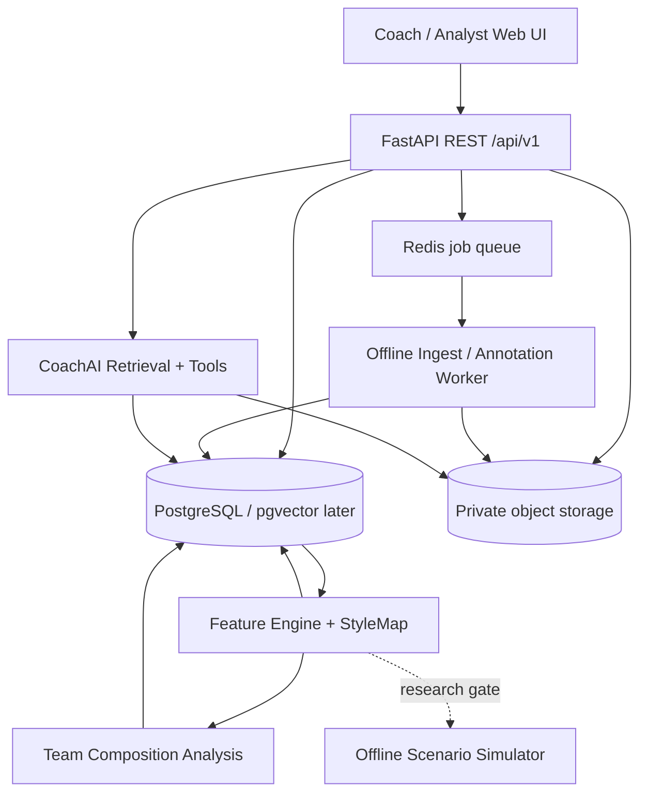

# 02 — System Architecture

## Architecture principle
Start with a modular monolith API plus worker and browser UI. A multi-agent AI *product* need not be a multi-service distributed system on day one. Add Ray only when batch scaling has a measured benefit. Maintain clean adapters so rights-cleared data and future approved telemetry sources plug into one canonical event schema.

## Bounded components

| Module | Inputs | Outputs | Ownership |
|---|---|---|---|
| `auth_access` | identity, org membership | permissions, audit | API |
| `ingestion` | authorized video + provenance | source/media, processing job | API + worker |
| `annotation` | video times and observer labels | versioned verified events | API |
| `canonical_events` | annotations and approved source adapters | typed event stream | worker |
| `feature_engine` | validated contextual events | versioned feature tensors with masks | ML package |
| `style_map` | player tensors | neighbors, category assignments, explanations | ML package |
| `coach_ai` | user question and scoped retrieval | grounded answer + citations | API |
| `composition` | team picks, player styles and observed teamwork | context descriptive measures | analytics module |
| `scenario` | optional verified transition dataset | bounded action distributions | research package |

## Architecture guardrails

- API does **not** expose object-store unscoped URLs. Clips delivered by short-lived signed URLs after checking org, role and source permission.
- Browser never accesses LLM provider API secrets or official-game API keys.
- Task queue records job metadata in DB; Redis may dispatch but DB remains source of truth. Retries by stable input hash, processing-version and job type.
- Store semantic schema version on each event, feature recipe and ML model. Invalidate dependent derived artifacts if annotation, consent or preprocessing changes.
- AI never creates canonical events without review; CV-assisted proposals receive `source=computer_vision_unverified` until accepted.
- Event and model lineage: `source_asset -> annotation -> normalized_event -> feature_set -> twin_version -> cluster_version -> answer_citation`.
- Permission scope is applied **before** semantic search; never retrieve cross-tenant vectors then filter only the final answer.

## Deployment topology

Local dev: Compose Postgres, Redis, MinIO (or private local adapter), Next.js, FastAPI, RQ/Celery worker. Pilot: managed Postgres, private S3-compatible storage, queue, API/web and asynchronous worker; HTTPS and automatic backups. Optional pgvector when unstructured notes justify embedding search; structured DB filters first.

## Configuration

`DATABASE_URL`, `REDIS_URL`, `STORAGE_PROVIDER`, `STORAGE_BUCKET`, `STORAGE_ENDPOINT`, `APP_PUBLIC_URL`, `JWT_SIGNING_KEY` or identity-provider config, `MAX_UPLOAD_BYTES`, `UPLOAD_ALLOWED_MIME`, `LLM_PROVIDER`, `LLM_MODEL`, `LLM_API_KEY` (optional), `ENABLE_EXTERNAL_RIOT=false`, `ENABLE_GRID=false`, `ENABLE_SIMULATION=false`, `DEMO_SYNTHETIC=true`.

## Performance and event lifecycles

1. `POST /assets` validates rights declaration and responds with upload target and asset ID.
2. Browser uploads bytes; server records SHA-256 and optional FFprobe metadata.
3. Worker queues thumbnail/transcode or skips if source unsuitable; does **not** automatically claim to extract player positions.
4. Analyst labels rounds/events; reviewer verifies fields; feature engine detects verified event update.
5. Versioned feature job recomputes affected player/patch slice, category embeddings and nearest-neighbor indexes.
6. CoachAI retrieves **only** verified evidence available to requester and generates attributable summary.

## Data isolation

Every tenant-owned table contains `organization_id`, even if it has an FK to another scoped record. Query services enforce organization scope. For high assurance, consider Postgres RLS as defense in depth; test regardless. Files encrypted at rest and TLS in transit. Prefer opaque IDs; public username/handle optional and opt-in.

## Observability

Structured JSON logs with trace IDs and sanitized fields, OpenTelemetry request spans and per-stage job spans, retry/dead-letter metrics, data source and annotation error counters, feature-drift dashboards, LLM cost/latency and citation validator failures. No VOD pixels or private text in error logs.

## State machine

Asset: `created -> uploading -> uploaded -> processing -> needs_review -> ready` or `failed/rejected/deleted`. Job: `queued -> running -> complete | failed | canceled`, retries increment attempt counter. Feature-set: `pending -> generating -> ready | insufficient_data | invalidated`. All state transitions validated server-side.
